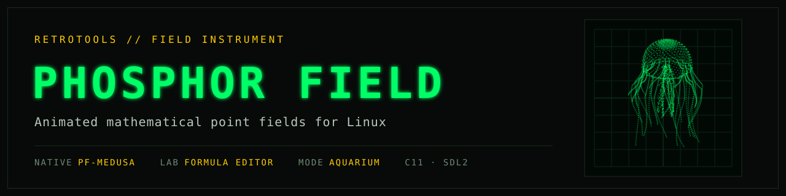
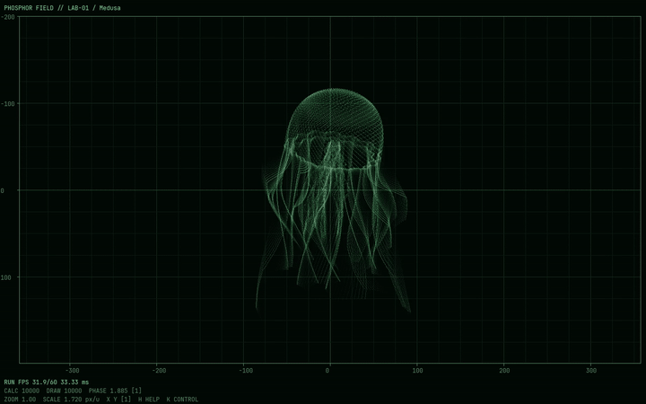
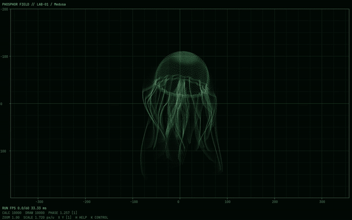
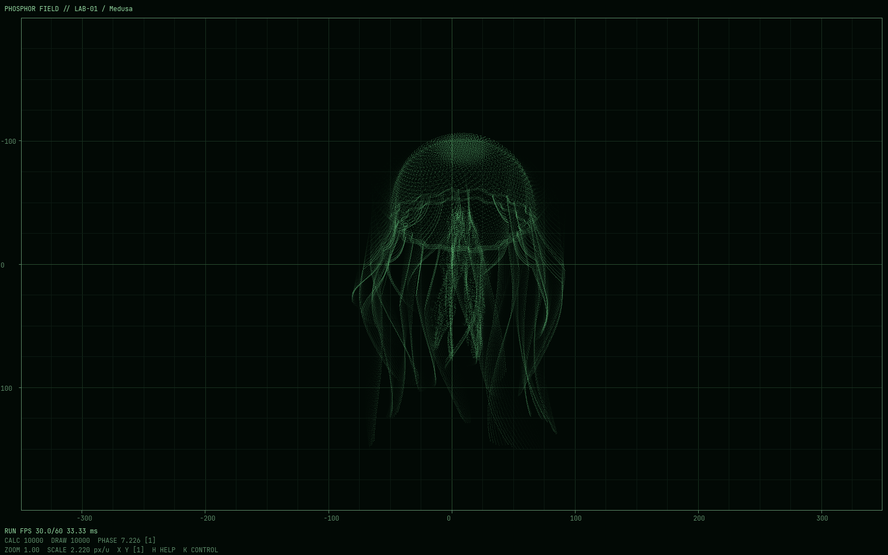
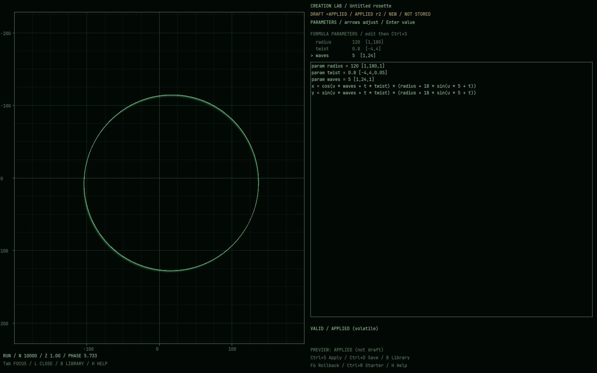
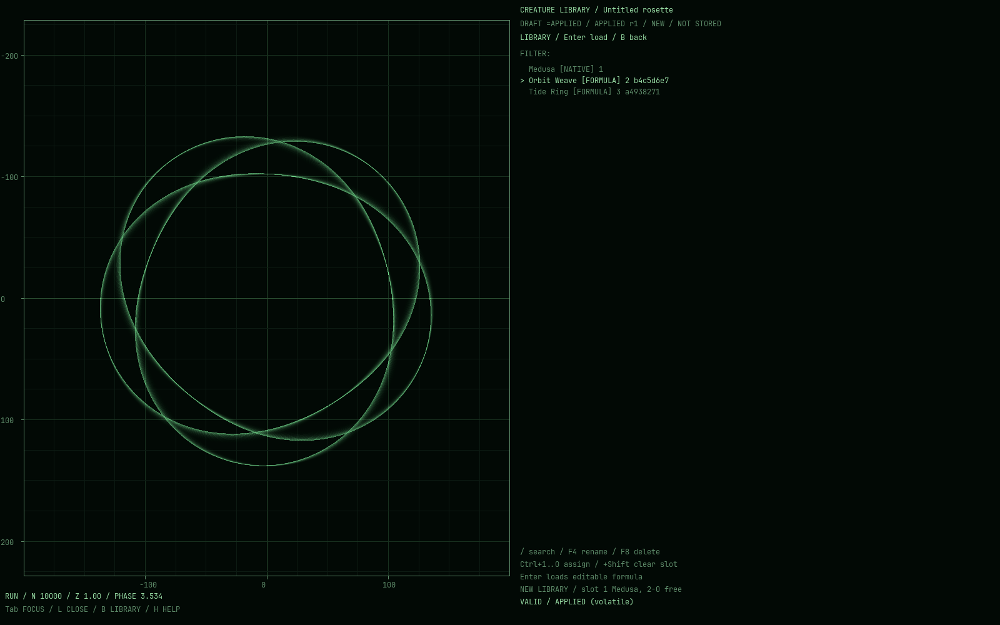
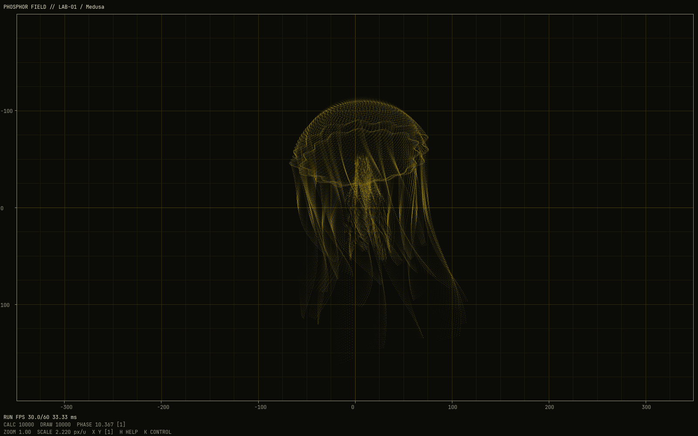

<p align="center">
  
</p>

**Phosphor Field** is a small native instrument that draws living mathematics. Tens of
thousands of points are computed every frame and drawn onto a dark measurement grid with
phosphor afterglow. You can watch the built-in creature, write your own in a tiny formula
language, keep them in a local library and let them take turns in an Aquarium.

It is one C11 binary built on SDL2 and SDL2_ttf. It has no network code, no services and no telemetry.

<p align="center">
  
  <br><sub>The real app window: <b>PF-MEDUSA</b>, the built-in creature, at the default 10 000 points.</sub>
</p>

## Meet PF-MEDUSA

PF-MEDUSA is an explicit 3D body rather than a flat formula. It is rebuilt from scratch on every frame.

- **A real swim stroke.** The bell contracts fast and relaxes slowly, and the body lifts a moment later.
- **Tentacles with memory.** Every tentacle point follows the bell rim *as it was a moment ago*, so each stroke travels down the tentacles as a wave.
- **Bioluminescence.** One light wave per beat runs from the apex over the bell and down the tentacles. It is made purely by moving sample density, so no colour trick is involved.
- **A phyllotaxis bell.** The bell is sampled on a golden-angle spiral, which shimmers as moiré while the body turns in 3D.
- **A rare deep tilt.** About once a minute it leans far enough to show the tentacle star from above.

How it was designed, its maths and its provenance are in [docs/CREATURE_MEDUSA.md](docs/CREATURE_MEDUSA.md).

## What else it does

<p align="center">
  
  <br><sub>Real app window: <b>Creation Lab</b> parameter edits applied live, then the <b>Aquarium</b> cross-fading between favourites.</sub>
</p>

| PF-MEDUSA — key `1` | Creation Lab — key `L` | Creature Library — key `B` |
| :---: | :---: | :---: |
| <a href="docs/media/medusa.png"></a> | <a href="docs/media/lab.png"></a> | <a href="docs/media/library.png"></a> |
| The built-in creature with live telemetry. | Write `x`/`y` formulas with named parameters; the preview updates on apply. | Save, rename, search and assign creatures to favourite keys `1`…`0`. |

- **Creation Lab.** Write a creature as two expressions with up to eight named, bounded parameters. Invalid drafts never replace the running preview, and errors point to line and column.
- **Creature Library.** Up to 64 own creatures, saved atomically with a backup and assignable to ten favourite keys.
- **Aquarium (`A`).** Your favourites take turns with a 1 s cross-fade. Each is shown for 5–120 s, 15 s by default.
- **Instrument controls.** Point count from 2 500 to 50 000, speed, zoom, grid, persistence and decay, all on single key presses.
- **Adaptive layout.** It works in small tiling-window-manager tiles and degrades to a status view instead of breaking.
- **Theme-aware.** It follows the active Omarchy palette live when one is present, and otherwise uses the fixed phosphor palette.

<p align="center">
  <a href="docs/media/theme.png"></a>
  <br><sub>The same creature with a sulfur palette (<code>--theme-file tests/fixtures/sulfur-night.toml</code>).</sub>
</p>

All images above are real captures of Phosphor Field 0.6.0. They are produced headlessly by
[`tools/showcase/capture.sh`](tools/showcase/capture.sh), which drives the unmodified render
path with scripted key presses and a fixed 30 fps clock. The two formula creatures in the tour
were written for the showcase and exist only in a temporary library.

## Requirements

- Linux on x86_64 with a desktop session (Wayland or X11 through SDL2).
- A C11 compiler, `make` and `pkg-config` (or `pkgconf`).
- SDL2 and SDL2_ttf development files.
- One monospace TTF. DejaVu Sans Mono, JetBrains Mono Nerd Font and Liberation Mono are found automatically; any other font works with `PHOSPHOR_FONT=/path/to/font.ttf`.
- Python 3, only for `make check-integration` and `make check-aquarium`.

**Tested for 0.6.0:** Omarchy (Arch-based), x86_64, Hyprland on Wayland. The toolchain was GCC 16.2,
sdl2-compat 2.32 and SDL2_ttf 2.24. Other distributions, X11 sessions and classic SDL2 builds have
**not** been tested yet. See [docs/QA.md](docs/QA.md).

```sh
# Arch / Omarchy (tested)
sudo pacman -S --needed base-devel pkgconf sdl2-compat sdl2_ttf ttf-dejavu
# Debian / Ubuntu (untested)
sudo apt install build-essential pkg-config libsdl2-dev libsdl2-ttf-dev fonts-dejavu-core
# Fedora (untested)
sudo dnf install gcc make pkgconf-pkg-config SDL2-devel SDL2_ttf-devel dejavu-sans-mono-fonts
```

If SDL2 or SDL2_ttf is missing, `make` stops at once and names it.

## Quickstart

```sh
make
./phosphor-field                    # follows your Omarchy theme, if any
./phosphor-field --theme phosphor   # the fixed phosphor-green palette
```

Press `↑` a few times for more points, `L` for the Creation Lab, `A` for the Aquarium and `Q` to quit.

## Controls

| Key | Action |
| --- | --- |
| `1` … `0` | Favourite slots. Initially `1` is PF-MEDUSA and `2`–`0` are free. |
| `Space` / `R` | Pause / reset view and parameters to defaults |
| `↑` `↓` | Points ±2 500 (2 500 to 50 000) |
| `←` `→` | Speed ±0.25 (0.25× to 4×) |
| `+` `-` | Zoom (0.25× to 4×) |
| `G` / `P` | Grid / phosphor persistence on or off |
| `N` `M` (also `[` `]`) | Shorter / longer decay (35 to 600 ms) |
| `A` | Aquarium on or off. While it runs, `,` `.` change the interval and `Esc` returns. |
| `L` / `B` | Creation Lab / Creature Library |
| `H` / `K` | Help / control bay |
| `Q`, `Esc` or closing the window | Quit (asks once if a Lab draft is unsaved) |

In the Creation Lab:

| Key | Action |
| --- | --- |
| `Tab` | Move focus between preview, parameters and editor |
| `Ctrl+S` | Validate and apply the draft |
| `Ctrl+D` / `Ctrl+Shift+S` | Save / save as a new creature |
| `F6` / `F7` | Restore the last applied text / the previous valid version |
| `Ctrl+R` | Start again from the starter formula |

In the Library: `/` searches, `Enter` loads, `F4` renames and `F8` then `Y` deletes. `Ctrl+1`…`0` assigns the selected entry to a favourite slot, and `Ctrl+Shift+1`…`0` clears that slot.

A minimal formula:

```text
param waves = 5 [1,24,1]
x = cos(u * waves + t) * (120 + 18 * sin(u * 5 + t))
y = sin(u * waves + t) * (120 + 18 * sin(u * 5 + t))
```

`u` runs over 0…2π across the samples, `i` is the sample index and `t` the animation phase. You have `+ - * /`, `sin cos abs sqrt pow min max` and `pi`. The language is deliberately small: there are no loops, conditions, file access or native code. The full reference is in [docs/ARCHITECTURE.md](docs/ARCHITECTURE.md).

Command line (excerpt): `phosphor-field [--size W H] [--points N] [--seconds N] [--theme auto|phosphor] [--theme-file FILE] [--status-json] [--log-dir DIR] [--screenshot FILE.bmp] [--version] [--help]`.

## Install, uninstall

```sh
make install PREFIX=$HOME/.local     # or: sudo make install (PREFIX=/usr/local)
make uninstall PREFIX=$HOME/.local   # removes exactly that one file
```

`make install` copies one binary to `$(PREFIX)/bin` and supports `DESTDIR`. Your library and
settings are not touched by uninstall. Remove them yourself if you want to (see below).

## Your data, privacy and security

| Question | Answer |
| --- | --- |
| What does it store? | Only what you save: `library.pfl` (with a `.bak` of the previous version) and `settings.pfs` in `$XDG_DATA_HOME/phosphor-field/` (default `~/.local/share/phosphor-field/`). Nothing is written at startup. |
| Does it log? | Not by default. File logs exist only with `--log-dir DIR`. They are bounded and rotated, and they contain no key codes, user names, host names or full paths. |
| Does it use the network? | No. There is no networking code. |
| What does it read? | Your fonts, its own data files and, for `--theme auto`, `~/.local/state/omarchy/current/theme/colors.toml`. It reads that file only; it never changes your theme. |
| Are formulas safe to load? | Formulas compile to a bounded bytecode with at most 384 operations per point and 32 nesting levels, and they cannot touch files or run code. Library files are size-limited, symlinks are refused and files are never auto-repaired. |
| Which permissions does it need? | Only a normal desktop user. No root rights, capabilities or device files. |

More detail and how to report a vulnerability: [SECURITY.md](SECURITY.md).

## Tests and QA

```sh
make check              # unit, render and headless smoke tests (SDL dummy driver)
make sanitize           # the same suites under AddressSanitizer and UBSan
make check-integration  # processes, JSON status stream, pipes, logs, live palette swaps
make check-aquarium     # real event loop: Aquarium at 10k and 50k points
```

All tests run in private temporary directories and never touch your library or desktop.
Results for this release, with environment and what was *not* tested, are in [docs/QA.md](docs/QA.md).

## Known limitations

- It is an art instrument, not a calibrated plotter. There is no 60 fps guarantee at 50 000 points with heavy formulas or on software rendering.
- Theme following is built for Omarchy's palette file. On other desktops it uses the fixed phosphor palette, or `--theme-file` points it at a palette.
- Only ASCII is accepted in names and formulas. Formulas are limited to 2 047 bytes and eight parameters.
- The library is read at startup. Changes made to it by another process are refused rather than merged; restart instead.
- Fractional scaling, multi-monitor setups and X11 sessions are untested.
- Libraries written by unreleased development builds refer to creatures that no longer exist. They are refused read-only and never rewritten.

## License

Phosphor Field is released under the [MIT License](LICENSE). It links dynamically to SDL2 and
SDL2_ttf (both zlib license) and bundles no third-party code, fonts or media; see
[THIRD_PARTY_NOTICES.md](THIRD_PARTY_NOTICES.md).

Part of **RetroTools**, a family of small retro-styled Linux tools.
[Changelog](CHANGELOG.md) · [Release notes](docs/RELEASE_NOTES_v0.6.0.md) · [Architecture](docs/ARCHITECTURE.md)
